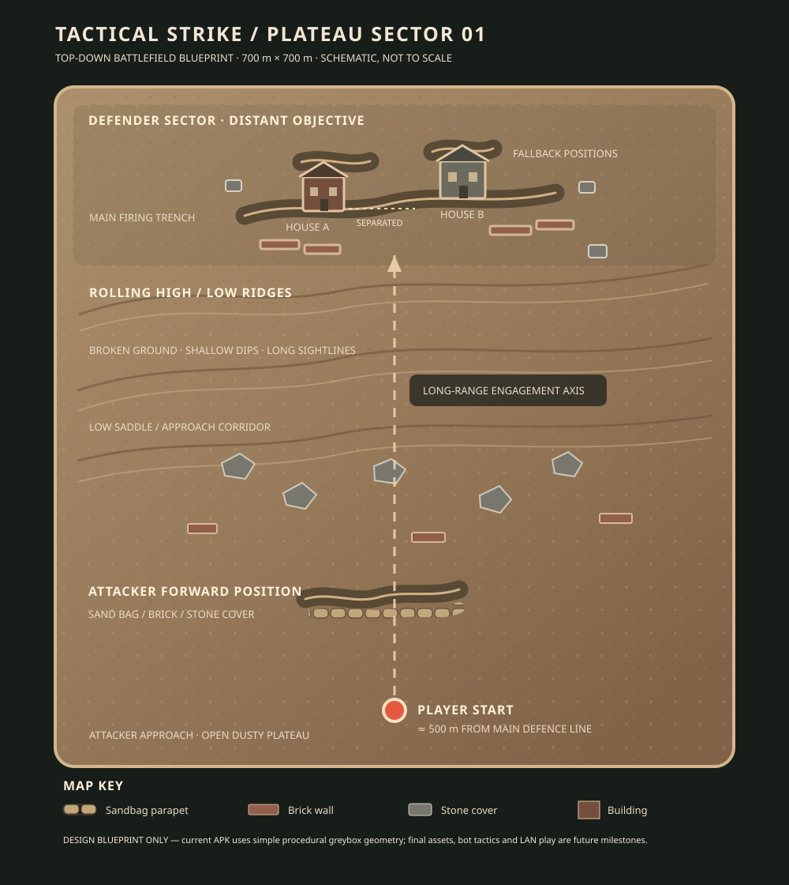

# Battlefield blueprint — Plateau Sector 01

This is the first-map layout guide for the initial prototype. It translates the requested battlefield into a layout that can be inspected directly on GitHub without installing the Godot editor.

## Layout and distance

The procedural test map is 700 m × 700 m. The player starts near the southern/attacker side at approximately `(0, +292)`. The main defender firing line is around `z = -205`, so its straight-line separation from the spawn is approximately 497 m before accounting for terrain height and the route actually taken.

The map is arranged in five depth bands:

1. **Defender sector at the far end:** two separated building shells, a main firing trench, a fallback trench and short brick/stone wall positions.
2. **Broken midfield:** alternating ridges, lower saddles and dips that interrupt some sightlines without closing the long-range view.
3. **Approach firing cover:** scattered stone and brick cover placed on the rolling ground.
4. **Attacker forward position:** a shallow trench cut and sandbag parapet near the southern approach.
5. **Player start:** an open, dusty-earth area with a long view toward the defensive line.

## Ground and distance readability

The palette is dry plateau earth rather than pale sand dunes or lush grass. The initial procedural terrain is a greybox surface; the next visual refinement pass will add better soil variation, edge wear, rocks and more convincing trench profiles.

A restrained depth haze is enabled to make the far defensive area lose contrast gradually. The intention is to retain readable distant silhouettes and let them become clearer as the player closes distance, not to hide the objective in thick fog.

## Current versus planned behavior

The current prototype includes the terrain, two simple building shells, trench/cover geometry, distant placeholder soldier silhouettes, first-person controller, weapon data, projectile simulation, tracers and impact effects.

The distant soldiers are **static placeholders**. The requested tactical AI—defenders changing trenches under suppression, falling back when overwhelmed, and attackers advancing cautiously with suppressive fire—is not yet implemented. Local Wi-Fi / hotspot multiplayer is also a future milestone.

The diagram is a layout guide, not a screenshot or a claim that final art is complete. The actual map is generated procedurally in `scripts/world/main_world.gd`.
